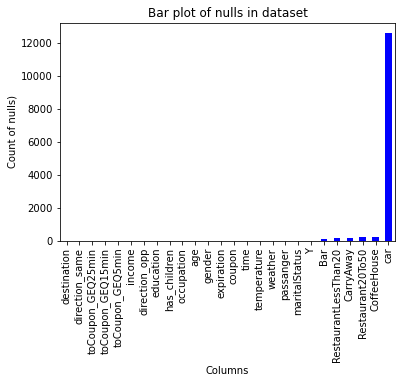
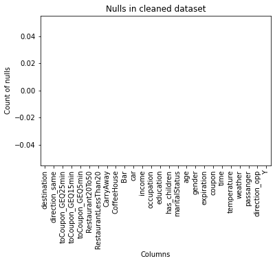
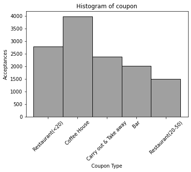
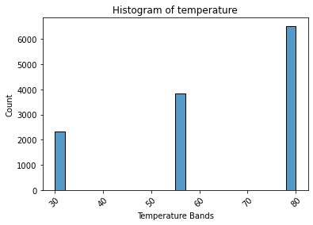

Required Assignment 5.1: Will the Customer Accept the Coupon?
~~~~~~~~~~~~~~~~~~~~~~~~~~~~~~~~~~~~~~~~~~~~~~~~~~~~~~~~~~~~~

**Context**

Imagine driving through town and a coupon is delivered to your cell
phone for a restaurant near where you are driving. Would you accept that
coupon and take a short detour to the restaurant? Would you accept the
coupon but use it on a subsequent trip? Would you ignore the coupon
entirely? What if the coupon was for a bar instead of a restaurant? What
about a coffee house? Would you accept a bar coupon with a minor
passenger in the car? What about if it was just you and your partner in
the car? Would weather impact the rate of acceptance? What about the
time of day?

Obviously, proximity to the business is a factor on whether the coupon
is delivered to the driver or not, but what are the factors that
determine whether a driver accepts the coupon once it is delivered to
them? How would you determine whether a driver is likely to accept a
coupon?

**Overview**

The goal of this project is to use what you know about visualizations
and probability distributions to distinguish between customers who
accepted a driving coupon versus those that did not.

**Data**

This data comes to us from the UCI Machine Learning repository and was
collected via a survey on Amazon Mechanical Turk. The survey describes
different driving scenarios including the destination, current time,
weather, passenger, etc., and then ask the person whether he will accept
the coupon if he is the driver. Answers that the user will drive there
‘right away’ or ‘later before the coupon expires’ are labeled as ‘Y = 1’
and answers ‘no, I do not want the coupon’ are labeled as ‘Y = 0’. There
are five different types of coupons – less expensive restaurants (under
$20), coffee houses, carry out & take away, bar, and more expensive
restaurants ($20 - $50).

**Deliverables**

Your final product should be a brief report that highlights the
differences between customers who did and did not accept the coupons. To
explore the data you will utilize your knowledge of plotting,
statistical summaries, and visualization using Python. You will publish
your findings in a public facing github repository as your first
portfolio piece.

Data Description
~~~~~~~~~~~~~~~~

Keep in mind that these values mentioned below are average values.

The attributes of this data set include: 1. User attributes - Gender:
male, female - Age: below 21, 21 to 25, 26 to 30, etc. - Marital Status:
single, married partner, unmarried partner, or widowed - Number of
children: 0, 1, or more than 1 - Education: high school, bachelors
degree, associates degree, or graduate degree - Occupation: architecture
& engineering, business & financial, etc. - Annual income: less than
\\$12500, \\$12500 - \\$24999, \\$25000 - \\$37499, etc. - Number of
times that he/she goes to a bar: 0, less than 1, 1 to 3, 4 to 8 or
greater than 8 - Number of times that he/she buys takeaway food: 0, less
than 1, 1 to 3, 4 to 8 or greater than 8 - Number of times that he/she
goes to a coffee house: 0, less than 1, 1 to 3, 4 to 8 or greater than 8
- Number of times that he/she eats at a restaurant with average expense
less than \\$20 per person: 0, less than 1, 1 to 3, 4 to 8 or greater
than 8 - Number of times that he/she goes to a bar: 0, less than 1, 1 to
3, 4 to 8 or greater than 8

2. Contextual attributes

   -  Driving destination: home, work, or no urgent destination
   -  Location of user, coupon and destination: we provide a map to show
      the geographical location of the user, destination, and the venue,
      and we mark the distance between each two places with time of
      driving. The user can see whether the venue is in the same
      direction as the destination.
   -  Weather: sunny, rainy, or snowy
   -  Temperature: 30F, 55F, or 80F
   -  Time: 10AM, 2PM, or 6PM
   -  Passenger: alone, partner, kid(s), or friend(s)

3. Coupon attributes

   -  time before it expires: 2 hours or one day

.. code:: ipython3

    import matplotlib.pyplot as plt
    import seaborn as sns
    import pandas as pd
    import numpy as np

Problems
~~~~~~~~

Use the prompts below to get started with your data analysis.

1. Read in the ``coupons.csv`` file.

.. code:: ipython3

    data = pd.read_csv('coupons.csv')

.. code:: ipython3

    data.head()
    #data.shape
    # 12_684 rows, 26 columns

.. raw:: html

    

    
    <table border="1" class="dataframe">
      <thead>
        <tr style="text-align: right;">
          <th></th>
          <th>destination</th>
          <th>passanger</th>
          <th>weather</th>
          <th>temperature</th>
          <th>time</th>
          <th>coupon</th>
          <th>expiration</th>
          <th>gender</th>
          <th>age</th>
          <th>maritalStatus</th>
          <th>...</th>
          <th>CoffeeHouse</th>
          <th>CarryAway</th>
          <th>RestaurantLessThan20</th>
          <th>Restaurant20To50</th>
          <th>toCoupon_GEQ5min</th>
          <th>toCoupon_GEQ15min</th>
          <th>toCoupon_GEQ25min</th>
          <th>direction_same</th>
          <th>direction_opp</th>
          <th>Y</th>
        </tr>
      </thead>
      <tbody>
        <tr>
          <th>0</th>
          <td>No Urgent Place</td>
          <td>Alone</td>
          <td>Sunny</td>
          <td>55</td>
          <td>2PM</td>
          <td>Restaurant(&lt;20)</td>
          <td>1d</td>
          <td>Female</td>
          <td>21</td>
          <td>Unmarried partner</td>
          <td>...</td>
          <td>never</td>
          <td>NaN</td>
          <td>4~8</td>
          <td>1~3</td>
          <td>1</td>
          <td>0</td>
          <td>0</td>
          <td>0</td>
          <td>1</td>
          <td>1</td>
        </tr>
        <tr>
          <th>1</th>
          <td>No Urgent Place</td>
          <td>Friend(s)</td>
          <td>Sunny</td>
          <td>80</td>
          <td>10AM</td>
          <td>Coffee House</td>
          <td>2h</td>
          <td>Female</td>
          <td>21</td>
          <td>Unmarried partner</td>
          <td>...</td>
          <td>never</td>
          <td>NaN</td>
          <td>4~8</td>
          <td>1~3</td>
          <td>1</td>
          <td>0</td>
          <td>0</td>
          <td>0</td>
          <td>1</td>
          <td>0</td>
        </tr>
        <tr>
          <th>2</th>
          <td>No Urgent Place</td>
          <td>Friend(s)</td>
          <td>Sunny</td>
          <td>80</td>
          <td>10AM</td>
          <td>Carry out &amp; Take away</td>
          <td>2h</td>
          <td>Female</td>
          <td>21</td>
          <td>Unmarried partner</td>
          <td>...</td>
          <td>never</td>
          <td>NaN</td>
          <td>4~8</td>
          <td>1~3</td>
          <td>1</td>
          <td>1</td>
          <td>0</td>
          <td>0</td>
          <td>1</td>
          <td>1</td>
        </tr>
        <tr>
          <th>3</th>
          <td>No Urgent Place</td>
          <td>Friend(s)</td>
          <td>Sunny</td>
          <td>80</td>
          <td>2PM</td>
          <td>Coffee House</td>
          <td>2h</td>
          <td>Female</td>
          <td>21</td>
          <td>Unmarried partner</td>
          <td>...</td>
          <td>never</td>
          <td>NaN</td>
          <td>4~8</td>
          <td>1~3</td>
          <td>1</td>
          <td>1</td>
          <td>0</td>
          <td>0</td>
          <td>1</td>
          <td>0</td>
        </tr>
        <tr>
          <th>4</th>
          <td>No Urgent Place</td>
          <td>Friend(s)</td>
          <td>Sunny</td>
          <td>80</td>
          <td>2PM</td>
          <td>Coffee House</td>
          <td>1d</td>
          <td>Female</td>
          <td>21</td>
          <td>Unmarried partner</td>
          <td>...</td>
          <td>never</td>
          <td>NaN</td>
          <td>4~8</td>
          <td>1~3</td>
          <td>1</td>
          <td>1</td>
          <td>0</td>
          <td>0</td>
          <td>1</td>
          <td>0</td>
        </tr>
      </tbody>
    </table>
    
5 rows × 26 columns

    

2. Investigate the dataset for missing or problematic data.

.. code:: ipython3

    # Finding missing and problematic data
    
    
    # Plot nulls across all columns
    data.isnull().sum().sort_values().plot(kind='bar', color='blue')
    plt.title('Bar plot of nulls in dataset')
    plt.xlabel('Columns')
    plt.ylabel('Count of nulls)')
    
    #Confirm no problematic values in destination, 'passanger', weather columns
    #Weather_values = data[['destination', 'passanger', 'weather']].apply(pd.Series.value_counts)
    #print(Weather_values)
    
    #Uncovering problematic values in Times Visited columns
    Times_Visited_values = data[['Bar', 'CarryAway', 'RestaurantLessThan20','Restaurant20To50',\
                              'CoffeeHouse']].apply(pd.Series.value_counts)
    print(Times_Visited_values)
    
    #Confirm no problematic values in coupon columns
    #Coupon_values = data[['coupon', 'expiration']].apply(pd.Series.value_counts)
    #print(Coupon_values)
    
    #Viewing data in coupon column
    #Coupon_values = data[['coupon']].apply(pd.Series.value_counts)
    #print(Coupon_values)
    
    
    #Confirm no problematic values in respondent columns
    #Respondent_values = data[['gender', 'age','maritalStatus', \
    #                        'has_children', 'education', 'occupation', \
    #                        'income']].apply(pd.Series.value_counts)
    #print(Respondent_values)
    
    #Confirm no problematic values in coupon timings columns (0 and 1 only)
    #Coupon_timings_values = data[['toCoupon_GEQ5min', 'toCoupon_GEQ15min', \
    #                             'toCoupon_GEQ25min', \
    #                             'direction_same','direction_opp']].apply(pd.Series.value_counts)
    #print(Coupon_timings_values)
    
    #Confirm no values of interest in car column
    #Car_values = data['car'].value_counts()
    #print(Car_values)
    

.. parsed-literal::

            Bar  CarryAway  RestaurantLessThan20  Restaurant20To50  CoffeeHouse
    1~3    2473       4672                  5376              3290         3225
    4~8    1076       4258                  3580               728         1784
    gt8     349       1594                  1285               264         1111
    less1  3482       1856                  2093              6077         3385
    never  5197        153                   220              2136         2962

3. Decide what to do about your missing data – drop, replace, other…

.. code:: ipython3

    # Data cleaning
    
    # Drop column 'car' and create new data_clean dataframe. 
    # Rationale: only 108 car rows (0.85%) have valid responses, none of which add value
    data_clean = data.drop(columns=['car'])
    
    # Replace remaining nulls in dataset with '0'
    data_clean = data.fillna(0)
    
    # Replace "less1" and "never" with '0'
    data_clean = data_clean.replace({"less1" : 0, "never": 0})
    
    #Confirming problematic values replaced in Times Visited columns
    Times_Visited_values1 = data_clean[['Bar', 'CarryAway', 'RestaurantLessThan20','Restaurant20To50',\
                              'CoffeeHouse']].apply(pd.Series.value_counts)
    print(Times_Visited_values)
    
    # bar plot confirming nulls replaced
    data_clean.isnull().sum().sort_values().plot(kind='bar', color='blue')
    plt.title('Nulls in cleaned dataset')
    plt.xlabel('Columns')
    plt.ylabel('Count of nulls')

.. parsed-literal::

            Bar  CarryAway  RestaurantLessThan20  Restaurant20To50  CoffeeHouse
    1~3    2473       4672                  5376              3290         3225
    4~8    1076       4258                  3580               728         1784
    gt8     349       1594                  1285               264         1111
    less1  3482       1856                  2093              6077         3385
    never  5197        153                   220              2136         2962

.. parsed-literal::

    Text(0, 0.5, 'Count of nulls')

4. What proportion of the total observations chose to accept the coupon?

.. code:: ipython3

    #Uses shape to return the number of observations
    obs, cols = data_clean.shape
    print(f"Rows: {obs}, Columns: {cols}")
    #Calculate proportion that accepted coupon (rounding to 1 decimal)
    Accept_proportion = round(data_clean['Y'].sum()  / obs * 100, 1)
    print("Accepting proportion is:", Accept_proportion, "%")

.. parsed-literal::

    Rows: 12684, Columns: 26
    Accepting proportion is: 56.8 %

5. Use a bar plot to visualize the ``coupon`` column.

.. code:: ipython3

    # Plotting coupon column (why bar plot and not histogram??
    sns.histplot(data=data_clean, x='coupon', color = 'grey')
    plt.title('Histogram of coupon')
    plt.xlabel('Coupon Type')
    plt.ylabel('Acceptances')
    plt.xticks(rotation=45)
    plt.show()

6. Use a histogram to visualize the temperature column.

.. code:: ipython3

    sns.histplot(data=data_clean, x='temperature')
    plt.title('Histogram of temperature')
    plt.xlabel('Temperature Bands')
    plt.ylabel('Count')
    plt.xticks(rotation=45)
    plt.show()

**Investigating the Bar Coupons**

Now, we will lead you through an exploration of just the bar related
coupons.

1. Create a new ``DataFrame`` that contains just the bar coupons.

.. code:: ipython3

    # New dataframe for bar coupons only 
    #Bar_coupon_data = data_clean.drop(['CarryAway','RestaurantLessThan20',\
    #                            'Restaurant20To50','CoffeeHouse'], axis=1)
    Bar_coupon_data = data_clean[data_clean["coupon"] == 'Bar']
    
    # Alternate method to create bar dataframe, but keeps the destination columns
    #Bar_coupon_data = data_clean[data_clean["coupon"] == 'Bar']

2. What proportion of bar coupons were accepted?

.. code:: ipython3

    #Uses shape to return the number of observations
    Bar_obs, Bar_cols = Bar_coupon_data.shape
    #print(f"Rows: {Bar_obs}, Columns: {Bar_cols}")
    
    # Code below sums the 1s in 'Y'. 0s have no effect
    Accepted_bar_coupons = Bar_coupon_data['Y'].sum()
    
    #Calculate proportion that accepted coupon (rounding to 1 decimal)
    Bar_proportion_accepted = round((Accepted_bar_coupons  / Bar_obs) * 100, 1)
    
    print("Number of bar coupons accepted is:", Accepted_bar_coupons)
    print("Accepting proportion of bar coupons is:", Bar_proportion_accepted, "%")

.. parsed-literal::

    Number of bar coupons accepted is: 827
    Accepting proportion of bar coupons is: 41.0 %

3. Compare the acceptance rate between those who went to a bar 3 or
   fewer times a month to those who went more.

.. code:: ipython3

    # Show 'Bar' column values
    #Bar_values = Bar_coupon_data[['Bar']].apply(pd.Series.value_counts)
    #print(Bar_values)
    # Result: 'Bar' column values are type integer '0' , the rest type str '1~3' , '4~8' , 'gt8' 
    
    # 4 or more bar visits per month. 
    Four_plus_bars_monthly = Bar_coupon_data[Bar_coupon_data['Bar'].isin(['4~8','gt8'])]
    Accepted_and_four_plus = Four_plus_bars_monthly['Y'].sum()
    # Result: 153 accepted that attend 4+ per month
    Four_plus_acceptance_rate = round((Accepted_and_four_plus / Accepted_bar_coupons) * 100, 1)
    print("Bar coupon acceptance rate for 4+ bar attendances:", Four_plus_acceptance_rate,"%")
    
    # 3 or less bar visits per month.
    three_or_less_bars_monthly = Bar_coupon_data[Bar_coupon_data['Bar'].isin([0,'1~3'])]
    Accepted_and_three_or_less = three_or_less_bars_monthly['Y'].sum()
    # Result - 674 accepted that attend 3 or less per month
    Three_or_less_acceptance_rate = round((Accepted_and_three_or_less / Accepted_bar_coupons) * 100, 1)
    print("Bar coupon acceptance rate for <=3 bar attendances:", Three_or_less_acceptance_rate,"%")

.. parsed-literal::

    Bar coupon acceptance rate for 4+ bar attendances: 18.5 %
    Bar coupon acceptance rate for <=3 bar attendances: 81.5 %

.. code:: ipython3

    4. Compare the acceptance rate between drivers who go to a bar more than once a month and are over the age of 25 to the all others.  Is there a difference

::

      Input In [12]
        4. Compare the acceptance rate between drivers who go to a bar more than once a month and are over the age of 25 to the all others.  Is there a difference
           ^
    SyntaxError: invalid syntax

.. code:: ipython3

    #Bar_coupon_data.head()
    
    # Code to review 'age' column data
    #age_values = data[['age']].apply(pd.Series.value_counts)
    #print(age_values)
    # Result: all strings: "below21" "21"" 26" "31" "36" "41" "46" "50plus"
    
    # Defines dataframe for respondents old enough to drink
    # ("26" + "31" + "36" + "41" + "46" + "50plus")
    Old_enough_to_drink = Bar_coupon_data[Bar_coupon_data['age'] \
        .isin(["26", "31" ,"36", "41", "46" , "50plus"])]
    Numbers_old_to_drink, old_cols = Old_enough_to_drink.shape
    print("Number of bar coupon respondents over 25:", Numbers_old_to_drink)
    
    # Those over 25 who accepted the bar coupon (summing makes use of 1s and 0s).
    Accepted_over25 = Old_enough_to_drink['Y'].sum()
    print("Number accepting a bar coupon and over 25:", Accepted_over25)
    
    # Acceptance rates for over 25s [I don't think I care...]
    print("Bar coupon acceptance rate for over 25s:", round((Accepted_over25 / Bar_obs) * 100, 1), "%")
    print()
    
    # Defining 'Regulars' dataframe for over 25s that visit bars frequently
    Regulars = Old_enough_to_drink[Old_enough_to_drink['Bar'] \
        .isin(["1~3", "4~8", "gt8"])]
    Number_Regulars, Regs_cols = Regulars.shape
    print("Number of regular bar attendees:", Number_Regulars)
    Num_Regulars_accepted = (Regulars['Y']==1).sum()
    print("Regular bar attendees that accepted a bar coupon:", Num_Regulars_accepted)
    Regulars_acceptance_rate = round((Num_Regulars_accepted / Number_Regulars)* 100, 1)
    print("Bar coupon acceptance rate for regulars:",Regulars_acceptance_rate, "%")
    print()
    
    # Defining the rest
    print("Bar coupon other recipients:", Bar_obs - Number_Regulars)
    print("Bar coupon other acceptances:", Accepted_bar_coupons - Num_Regulars_accepted)
    Bar_coupon_other_acceptance_rate = ((Accepted_bar_coupons - Num_Regulars_accepted)  \
    / (Bar_obs - Number_Regulars))*100
    print("Bar coupon other acceptances rate:", round(Bar_coupon_other_acceptance_rate,1))
    print()
    
    Too_young_to_drink = (Bar_coupon_data[Bar_coupon_data['age'] \
        .isin(["below21", "21"])])
    Numbers_young_to_drink, cols = Too_young_to_drink.shape                      
    print("Number of bar coupon respondents too young to drink:",Numbers_young_to_drink)

5. Use the same process to compare the acceptance rate between drivers
   who go to bars more than once a month and had passengers that were
   not a kid and had occupations other than farming, fishing, or
   forestry.

.. code:: ipython3

    #Find acceptance rate for bar coupon for regular bar visitors
    # with passengers (not a kid) + not farmer, fisher or forester.
    
    #Drivers at bars more than monthly
    Regulars_all_ages = Bar_coupon_data[Bar_coupon_data['Bar'] \
        .isin(["1~3", "4~8", "gt8"])]
    Num_Regulars_all_ages, Reg_age_cols = Regulars_all_ages.shape
    #print(Num_Regulars_all_ages)
    # Result : 596 regulars all ages
    Num_Regulars_all_ages_accepted = (Regulars_all_ages['Y']==1).sum()
    #print(Num_Regulars_all_ages_accepted)
    # Result : 410
    Regulars_all_ages_acceptance_rate = (Num_Regulars_all_ages_accepted / Num_Regulars_all_ages)*100
    print("Bar coupon acceptance rate for regular bar attendees is:", round(Regulars_all_ages_acceptance_rate, 1), "%")
        
    #Finding drivers with passengers who aren't kids
    
    #Checking values in 'passanger' column
    #Pax_values = Bar_coupon_data[['passanger']].apply(pd.Series.value_counts)
    #print(Pax_values)
    # Results are type str: "Alone", "Friend(s)", "Partner", "Kid(s)"
    
    Pax_no_kid = Bar_coupon_data[Bar_coupon_data['passanger'].isin(["Friend(s)", "Partner"])]
    #Check:
    #Pax_no_kid.shape
    #Result: 611
    
    #Refining further dataframe for those not a farmer, fisher or forester.
    #occupation_values = data[['occupation']].apply(pd.Series.value_counts)
    #print(occupation_values)
    #Result is str "Farming Fishing & Forestry"
    Pax_no_kid_not_farm_fish_forest = Pax_no_kid[Pax_no_kid['occupation'] \
       != "Farming Fishing & Forestry"]
    #Getting number via shape
    Num_pax_no_kid_not_fff, pax_col = Pax_no_kid_not_farm_fish_forest.shape
    #print(Num_pax_no_kid_not_fff)
    # result 610 (ie only dropped one driver from that occupation!)
    
    #Getting bar coupon acceptance number via sum()
    Pax_no_kid_not_farm_fish_forest_acceptances = (Pax_no_kid_not_farm_fish_forest['Y']==1).sum()
    #print(Pax_no_kid_not_farm_fish_forest_acceptances)
    #Result : 295
    Pax_no_kid_not_farm_fish_forest_acceptance_rate = \
    (Pax_no_kid_not_farm_fish_forest_acceptances / Num_pax_no_kid_not_fff) *100
    print("Acceptance rate with pax (not kids) nor Farm Fish Forest occupation:" \
          , round(Pax_no_kid_not_farm_fish_forest_acceptance_rate, 1), "%")

6. Compare the acceptance rates between those drivers who:

-  go to bars more than once a month, had passengers that were not a
   kid, and were not widowed *OR*
-  go to bars more than once a month and are under the age of 30 *OR*
-  go to cheap restaurants more than 4 times a month and income is less
   than 50K.

.. code:: ipython3

    
    # 1. looking for regular bar attendees with pax (not kids) and not widowed
    # Confirm data types in "maritalStatus" column
    #Marital_values = Bar_coupon_data[['maritalStatus']].apply(pd.Series.value_counts)
    #print(Marital_values)
    #Result of interest is type str "Widowed"
    
    # Create dataframe for drivers with pax not kids who are not widowed
    # Uses 'Pax_no_kid' dataframe created previously
    Pax_no_kid_not_widowed = Pax_no_kid[Pax_no_kid["maritalStatus"] != "Widowed"]
    Num_pax_no_kid_not_widowed, wid_cols = Pax_no_kid_not_widowed.shape
    #print(Num_pax_no_kid_not_widowed)
    #Result : 603 (8 were widowed)
    
    # Refine dataframe further for regular bar attendance
    Regular_pax_no_kid_not_widowed = Pax_no_kid_not_widowed[Pax_no_kid_not_widowed['Bar'] \
        .isin(["1~3", "4~8", "gt8"])]
    Num_regular_pax_no_kid_not_widowed, reg_pax_wid_cols = Regular_pax_no_kid_not_widowed.shape
    #print(Num_regular_pax_no_kid_not_widowed)
    # result: 195
    Regular_pax_no_kid_not_widowed_accepted = (Regular_pax_no_kid_not_widowed['Y']==1).sum()
    #print(Regular_pax_no_kid_not_widowed_accepted)
    #Result: 140
    Regular_pax_no_kid_not_widowed_accept_rate = \
            (Regular_pax_no_kid_not_widowed_accepted / Num_regular_pax_no_kid_not_widowed)*100 
    print("Acceptance rate of regular bar visitors with pax (not kids), not widowed:" \
    , round(Regular_pax_no_kid_not_widowed_accept_rate, 1), "%")
    
    
    # 2. Regular bar attendee dataframe previously created as 'Regulars_all_ages'
    # From previous all age strings: "below21" "21"" 26" "31" "36" "41" "46" "50plus"
    # Regular bar attendees under 30
    Reg_under30 = Regulars_all_ages[Regulars_all_ages['age'] \
        .isin(["below21", "21", "26"])]
    Num_reg_under30, reg_under30_col = Reg_under30.shape
    #print(Num_reg_under30)
    # Result : 345
    Reg_under30_accepted = (Reg_under30['Y']==1).sum()
    Reg_under30_accept_rate = (Reg_under30_accepted / Num_reg_under30)*100
    print("Acceptance rate of regular bar visitors under 30:" \
    , round(Reg_under30_accept_rate, 1), "%")
       
    
    # 3. Bar coupons received by those frequently attending cheap eats and on < $50k
    # Confirm data types in "RestaurantLessThan20" column
    #RestaurantLessThan20_values = data[['RestaurantLessThan20']].apply(pd.Series.value_counts)
    #print(RestaurantLessThan20_values)
    # Results: type str "1~3" , "4~8" , "less1" , "gt8" , "never"
    #Define dataframe for those who frequent cheap restaurants more than once per month
    
    Freq_cheap_eaters = Bar_coupon_data[Bar_coupon_data['RestaurantLessThan20'] \
        .isin(["1~3", "4~8", "gt8"])]
    
    # Confirm data types in "income" column
    #income_values = data[['income']].apply(pd.Series.value_counts)
    #print(income_values)
    # Results: type str "Less than $12500", "$12500 - $24999", "$25000 - $37499", "$37500 - $49999"
    Freq_cheap_eaters_less50k = Freq_cheap_eaters[Freq_cheap_eaters['income'] \
        .isin(["Less than $12500", "$12500 - $24999", "$25000 - $37499", "$37500 - $49999"])]
    Num_Freq_cheap_eaters_less50k, cheap_50k_col = Freq_cheap_eaters_less50k.shape
    #print(Num_Freq_cheap_eaters_less50k)
    # Result: 815 cheap eaters on <50k
    Freq_cheap_eaters_less50k_accepted = (Freq_cheap_eaters_less50k['Y']==1).sum()
    #print(Freq_cheap_eaters_less50k_accepted)
    # Result: 342 cheap eaters on <50k accepted bar coupons
    Freq_cheap_eaters_less50k_accept_rate = (Freq_cheap_eaters_less50k_accepted / Num_Freq_cheap_eaters_less50k)*100
    print("Acceptance rate of cheap eaters earning < 50k:" \
    , round(Freq_cheap_eaters_less50k_accept_rate, 1), "%")
    print() 

7. Based on these observations, what do you hypothesize about drivers
   who accepted the bar coupons?

.. code:: ipython3

    # Most drivers accepting bar coupons are olderregular bar visitors

Independent Investigation
~~~~~~~~~~~~~~~~~~~~~~~~~

Using the bar coupon example as motivation, you are to explore one of
the other coupon groups and try to determine the characteristics of
passengers who accept the coupons.

.. code:: ipython3

    #Exploring CoffeeHouse
    
    Coffee_coupon_data = data_clean[data_clean["coupon"] == 'Coffee House']
    coffee_obs, coffee_col = Coffee_coupon_data.shape
    print(coffee_obs,"CoffeeHouse coupons were received")
    Accepted_coffee_coupons = Coffee_coupon_data['Y'].sum()
    Coffee_proportion_accepted = round((Accepted_coffee_coupons  / coffee_obs) * 100, 1)
    print(Coffee_proportion_accepted, "% were accepted")
    print()
    Accepted_coffee_df = Coffee_coupon_data[Coffee_coupon_data['Y']== 1]
    #Computing how many coffee coupons were accepted
    Num_coffee_accepted, coff_accept_col = Accepted_coffee_df.shape
    #print(Num_coffee_accepted, "Coffee House coupons were accepted")
    
    # Inspect data types in "time" column
    #time_values = Accepted_coffee_df[['time']].apply(pd.Series.value_counts)
    #print(time_values)
    # Result : only 126 at 10pm, rest fairly even
    
    # Inspect data in "destination" column
    #destination_values = Accepted_coffee_df[['destination']].apply(pd.Series.value_counts)
    #Result "No Urgent Place"=1252, "Work"=407, "Home"=336
    
    Non_urgent_accept_coffee_df = Accepted_coffee_df[Accepted_coffee_df['destination']=="No Urgent Place"]
    Num_non_urgent_accept_coffees, non_urge_coff_col = Non_urgent_accept_coffee_df.shape
    #print(Num_non_urgent_accept_coffees)
    Non_urgent_coffee_proportion_accepted = (Num_non_urgent_accept_coffees / Num_coffee_accepted) * 100
    print(round(Non_urgent_coffee_proportion_accepted,1), \
          "% of those accepting CoffeeHouse coupons were non-urgent travellers")
    
    # Inspect data in "expiration" column
    #expiration_values = Accepted_coffee_df[['expiration']].apply(pd.Series.value_counts)
    #print(expiration_values)
    #Result "1d" = 1033, "2h" = 962
    
    

